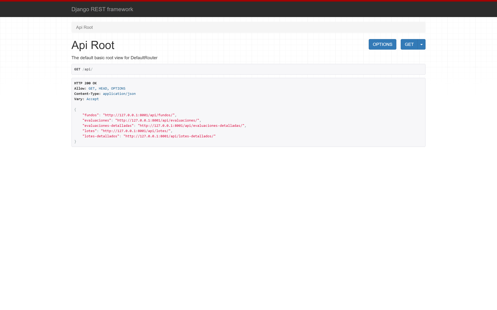
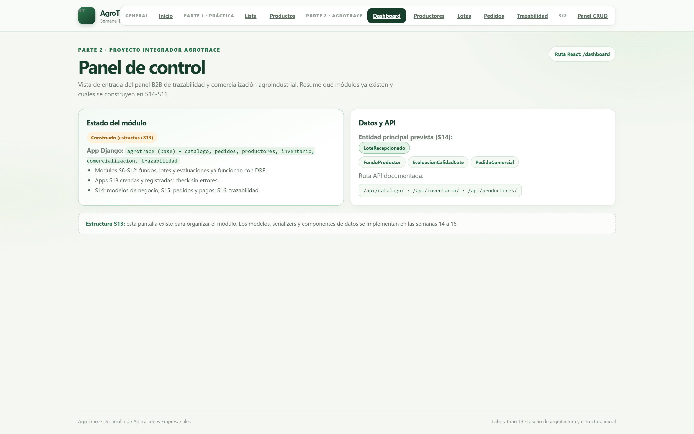
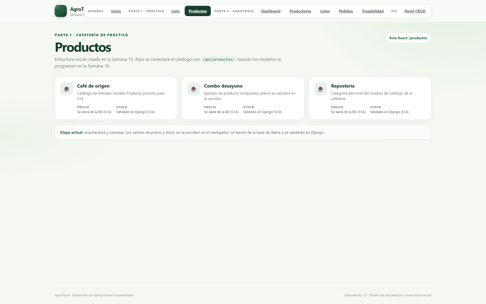
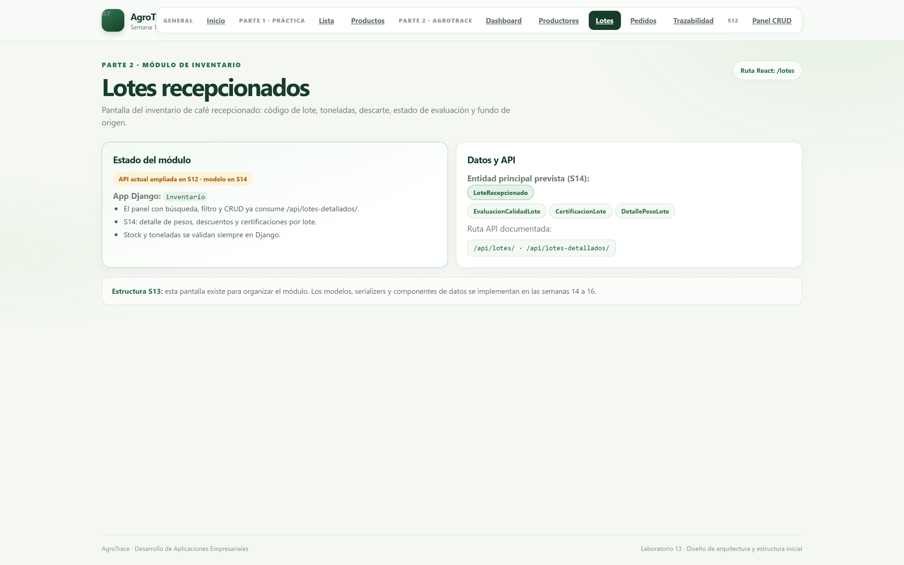

# AgroTrace · Laboratorio Semana 13


**Repositorio oficial:** <https://github.com/carlosjunco2025/AgrotraceLab13>

---

## Resumen ejecutivo

**AgroTrace** es una plataforma de **trazabilidad y comercialización agroindustrial B2B** con un canal público **B2C** de consulta. El sistema sigue el recorrido completo del producto: fondo/productor → recepción del lote → evaluación de calidad y certificaciones → inventario → comercialización y pedidos → entrega con trazabilidad consultable.

Esta Semana 13 entrega la **arquitectura y estructura inicial**: aplicaciones Django separadas por dominio, configuración de rutas/INSTALLED_APPS, la API REST base con `DefaultRouter` (fundos, evaluaciones y lotes) y el panel React con navegación, páginas base y una instancia única de Axios. Los modelos de negocio y las transacciones atómicas se implementan en la Semana 14; pagos y trazabilidad pública en las semanas 15–16.

---

## 1. Tipo de comercio y canales

| Canal | Tipo | Estado en S13 | Justificación |
|---|---|---|---|
| Plataforma de comercialización entre empresas (productores, acopiadores, exportadores) | **B2B** | Estructura creada (`comercializacion/`, `pedidos/`) | Permite negociar volumen, precios por kg, certificaciones y condiciones de despacho. Requiere roles, validación en servidor y trazabilidad completa del lote. |
| Consignación / acopio y distribución mayorista | **B2B** | Estructura creada (`inventario/`, `productores/`) | El inventario se gestiona por lote y toneladas, no por unidad minorista; el stock y el descarte se controlan en Django. |
| Consulta pública de trazabilidad (QR del lote) | **B2C** | Previsto (`trazabilidad/`) | El consumidor final sólo necesita leer origen, certificaciones y calidad; no modifica datos. Se habilitará como vista pública de sólo lectura. |
| Cafetería de práctica (catálogo y pedidos de prueba) | **B2C interno / demo** | Estructura creada (`catalogo/`, `pedidos/`) | Ejercicio guiado de clase para practicar `ForeignKey`, `PROTECT`, serializers y transacciones antes de trasladarlos al dominio agroindustrial. |

---

## 2. Mapa de módulos y roles de usuario

### Aplicaciones Django

| App | Responsabilidad | Estado S13 |
|---|---|---|
| `agrotrace` | Núcleo del proyecto: modelos `FundoProductor`, `LoteRecepcionado`, `EvaluacionCalidadLote`, `CertificacionLote` y API DRF con `DefaultRouter`. | Operativa desde S8–S12 |
| `catalogo` | Parte 1: catálogo de la cafetería de práctica. | Estructura creada |
| `pedidos` | Parte 1: pedidos, detalle y pago de la cafetería. | Estructura creada |
| `productores` | Registro de productores/fundos y sus datos de exportación. | Estructura creada |
| `inventario` | Lotes recepcionados, toneladas, descarte y stock. | Estructura creada |
| `comercializacion` | Pedidos comerciales, precios y negociación B2B. | Estructura creada |
| `trazabilidad` | Consulta pública y auditoría del recorrido del lote. | Estructura creada |

### Carpetas y archivos del frontend

| Ruta | Contenido |
|---|---|
| `frontend/src/api.js` | Instancia única de Axios (`baseURL` `/api/`, timeout y normalizador de errores). |
| `frontend/src/App.jsx` | `BrowserRouter`, barra de navegación agrupada y mapa completo de rutas. |
| `frontend/src/components/` | Componentes reutilizables (`ProductoCard`, `PanelLotes`). |
| `frontend/src/pages/` | Pantallas por ruta (`DashboardPage`, `ProductosPage`, `ProductoresPage`, `LotesPage`, `PedidosPage`, `TrazabilidadPage`, `PaginaBase`). |
| `frontend/src/practica/` | Lista CRUD de la Parte 1 (patrón de S12). |
| `frontend/src/App.css`, `frontend/src/pages/pages.css` | Sistema visual del panel. |

### Roles de usuario

| Rol | Permisos sobre el sistema | Módulos que usa |
|---|---|---|
| **Administrador** | Configuración general, alta de usuarios y catálogos maestros. | Todos |
| **Productor / titular del fondo** | Registra y edita sus fundos y lotes; consulta evaluaciones. | `productores`, `agrotrace` |
| **Inspector de calidad / recepción** | Registra recepción, nivel Brix, firmeza, descarte y certificaciones. | `agrotrace`, `inventario` |
| **Gestor de inventario y comercialización** | Administra stock, precios, pedidos B2B y despachos. | `inventario`, `comercializacion`, `pedidos` |
| **Cliente B2B / consumidor final** | Consulta catálogo, estado de pedido y trazabilidad (sólo lectura). | `trazabilidad`, `catalogo` |

---

## 3. Requisitos funcionales y no funcionales

### Requisitos funcionales

| ID | Requisito | Criterio de aceptación |
|---|---|---|
| **RF-01** | Registrar fundos/productores con datos de exportación. | Existe `FundoProductor` con `nombre_fundo`, `propietario_dni_ruc`, `hectareas`, `valido_exportacion` y `cupo_diario_lotes`. |
| **RF-02** | Registrar lotes recepcionados y su evaluación. | `LoteRecepcionado` se relaciona con `FundoProductor` y `EvaluacionCalidadLote` (1:1); el código de lote es único. |
| **RF-03** | Gestionar certificaciones por lote. | Relación N:M mediante la tabla intermedia `CertificacionLote` con `fecha_auditoria`, `codigo_inspeccion` y `costo_auditoria`. |
| **RF-04** | Exponer la API REST de fundos, evaluaciones y lotes. | `GET /api/` lista `fundos`, `evaluaciones`, `evaluaciones-detalladas`, `lotes` y `lotes-detallados` con respuesta 200. |
| **RF-05** | Mostrar el panel de módulos AgroTrace en React. | `GET /dashboard` renders navbar, módulo de estado y entidades principales sin errores de consola. |
| **RF-06** | Navegar entre la práctica de cafetería y el dominio AgroTrace. | Las rutas `/productos`, `/lotes`, `/pedidos`, `/trazabilidad` están enlazadas desde la barra superior. |

### Requisitos no funcionales verificables

| ID | Requisito | Criterio de aceptación |
|---|---|---|
| **RNF-01** | Arquitectura desacoplada. | Django sirve JSON; React consume Axios; sin plantillas Django mezcladas con el panel. |
| **RNF-02** | Configuración centralizada. | `INSTALLED_APPS`, CORS y `ROOT_URLCONF` definidos en `agrotrace_config/settings.py`. |
| **RNF-03** | Calidad de código. | `python manage.py check` → *0 issues*; `npm run lint` sin errores. |
| **RNF-04** | Compilación del frontend. | `npm run build` genera `frontend/dist/` sin errores (artefacto ignorado por Git). |
| **RNF-05** | Seguridad perimetral. | CORS restringido a `http://localhost:5173` y `http://127.0.0.1:5173`; secretos y base de datos fuera del control de versiones. |

---

## 4. Reglas de negocio y seguridad en el servidor

| ID | Regla de negocio | Aplicación |
|---|---|---|
| **RN-01** | Un lote pertenece obligatoriamente a un fundo. | `ForeignKey(FundoProductor, on_delete=CASCADE)`. |
| **RN-02** | El código de lote es único en todo el sistema. | `CharField(unique=True)`. |
| **RN-03** | El descarte no puede ser negativo. | `DecimalField(default=0.00)` validado en el serializer en S14. |
| **RN-04** | Sólo lotes `PROCESADO` son considerados conformes. | `LoteQuerySet.aprobados()` filtra `estado_evaluacion='PROCESADO'`. |
| **RN-05** | Los lotes con descarte > 2.0 se marcan para revisión. | `LoteQuerySet.con_alto_descarte(umbral=2.0)`. |
| **RN-06** | Cada lote tiene como máximo una evaluación de calidad. | `OneToOneField` desde `EvaluacionCalidadLote`. |
| **RN-07** | Una certificación no se registra dos veces para el mismo lote. | `unique_together = ('lote', 'certificacion')` en `CertificacionLote`. |

**Justificación de seguridad en el servidor.** Todas estas reglas se validan en Django (modelo, queryset, serializer y vista), nunca en el navegador. React puede ocultar un botón o deshabilitar un campo, pero eso es sólo usabilidad: si un cliente modifica la petición, el servidor vuelve a validar el tipo, los límites, la unicidad y la relacion entre entidades antes de escribir en SQLite. El precio, el stock y los totales también se calculan en el servidor (Semana 14) para evitar que el usuario altere montos desde DevTools. CORS limita qué orígenes pueden consumir la API y `DEBUG`/`SECRET_KEY` se mantienen bajo control de configuración.

---

## 5. Arquitectura en capas y flujo operativo

```text
  NAVEGADOR (React 19 + Vite)
  ┌──────────────────────────────────────────────────────────┐
  │ App.jsx → Navbar → Páginas (Dashboard, Productos, Lotes) │
  │              │ api.js (Axios, baseURL /api/)             │
  └──────────────┼───────────────────────────────────────────┘
                 │ HTTP/JSON (CORS: 5173 → 8000)
  ┌──────────────▼───────────────────────────────────────────┐
  │ CAPA DE PRESENTACIÓN API (Django REST Framework)         │
  │ DefaultRouter ──► ViewSets (fundos, evaluaciones, lotes) │
  └──────────────┬───────────────────────────────────────────┘
                 │ Serializers (validan y convierten)
  ┌──────────────▼───────────────────────────────────────────┐
  │ CAPA DE DOMINIO (apps Django)                            │
  │ agrotrace · catalogo · pedidos · productores             │
  │ inventario · comercializacion · trazabilidad             │
  └──────────────┬───────────────────────────────────────────┘
                 │ ORM de Django
  ┌──────────────▼───────────────────────────────────────────┐
  │ CAPA DE DATOS: SQLite (db.sqlite3, ignorada por Git)      │
  └──────────────────────────────────────────────────────────┘
```

**Flujo comercial operativo**

1. El **productor** registra su fondo y entrega un lote; se genera un `codigo_lote` único.
2. **Recepción** registra toneladas brutas y porcentaje de descarte; el lote nace en estado `PENDIENTE`.
3. **Calidad** registra la evaluación 1:1 (Brix, firmeza) y las certificaciones N:M; el lote pasa a `PROCESADO` si cumple RN-04.
4. **Inventario** publica el stock disponible por lote a través de `/api/lotes/`.
5. **Comercialización** crea el pedido B2B; desde S14 el total se calcula en Django dentro de `transaction.atomic`.
6. **Despacho y trazabilidad**: el cliente recibe el lote y consulta su origen y certificaciones desde `/trazabilidad`.

---

## 6. Estructura del repositorio y mapa de rutas

```text
AgrotraceLab13/
├── manage.py
├── requirements.txt
├── agrotrace_config/        # settings, urls, wsgi, asgi
├── agrotrace/               # núcleo: modelos, vistas, serializers, api_views, router
├── catalogo/ pedidos/       # Parte 1 · cafetería de práctica
├── productores/ inventario/ comercializacion/ trazabilidad/   # Parte 2 · dominio
├── docs/evidencias/         # capturas reales de la Semana 13
└── frontend/
    ├── package.json  vite.config.js  eslint.config.js
    └── src/
        ├── api.js  App.jsx  App.css
        ├── components/   # ProductoCard, PanelLotes
        ├── pages/        # páginas del panel + pages.css
        └── practica/     # lista CRUD S12
```

### API Django

| Método | Ruta | Descripción |
|---|---|---|
| GET | `/api/` | API root navegable de DRF con todos los endpoints. |
| GET/POST | `/api/fundos/` `…/{id}/` | Listado y detalle de fundos productores. |
| GET/POST | `/api/evaluaciones/` `…/{id}/` | Evaluaciones de calidad. |
| GET/POST | `/api/evaluaciones-detalladas/` `…/{id}/` | Evaluaciones con detalle ampliado. |
| GET/POST | `/api/lotes/` `…/{id}/` | Lotes recepcionados. |
| GET/POST | `/api/lotes-detallados/` `…/{id}/` | Lotes con información ampliada y búsqueda. |
| GET | `/api/catalogo/` `/api/pedidos/` `/api/productores/` `/api/inventario/` `/api/comercializacion/` `/api/trazabilidad/` | Metadata de los módulos creados en S13. |
| GET/POST/… | `/agrotrace/fundos/` `/agrotrace/lotes/` `/agrotrace/recepcion-transaccional/` `/agrotrace/reporte/` | Vistas HTML del núcleo heredadas de S12. |
| GET | `/admin/` | Sitio de administración de Django. |

### Frontend React

| Ruta | Pantalla |
|---|---|
| `/` y `/dashboard` | Panel de control del proyecto integrador. |
| `/practica` | Lista CRUD de la Parte 1. |
| `/productos` | Estructura de la cafetería (Parte 1). |
| `/panel` | Panel transaccional de lotes (S12). |
| `/productores` | Módulo de productores. |
| `/lotes` | Inventario de lotes recepcionados. |
| `/pedidos` | Pedidos comerciales. |
| `/trazabilidad` | Consulta de trazabilidad. |

---

## 7. Galería de Evidencias Visuales (Semana 13)

**API root navegable de DRF.** Muestra los cinco ViewSets registrados por `DefaultRouter` bajo `/api/`: `fundos`, `evaluaciones`, `evaluaciones-detalladas`, `lotes` y `lotes-detallados`, además de los endpoints de metadata de las apps S13.



**Panel React en `/dashboard`.** Barra de navegación agrupada (General, Parte 1, Parte 2 AgroTrace, S12) y módulo de control con entidad principal `LoteRecepcionado`, entidades relacionadas y estado de cada etapa.



**Vista `/productos`.** Estructura de la cafetería de práctica: tarjetas reutilizables `ProductoCard`, mensaje de etapa y aviso de que precio y stock se leerán de la base de datos en la Semana 14.



**Vista `/lotes`.** Módulo de inventario con el código de lote, toneladas, descarte, estado de evaluación y fundo de origen; enlazado desde `/trazabilidad` para la consulta del recorrido.



---

## 8. Guía de instalación, ejecución y verificación

```powershell
# 1) Clonar e ingresar
git clone https://github.com/carlosjunco2025/AgrotraceLab13.git
cd AgrotraceLab13

# 2) Backend
python -m venv .venv
.\.venv\Scripts\python.exe -m pip install -r requirements.txt
.\.venv\Scripts\python.exe manage.py check
.\.venv\Scripts\python.exe manage.py migrate
.\.venv\Scripts\python.exe manage.py runserver 127.0.0.1:8000

# 3) Frontend (otra terminal)
cd frontend
npm install
npm run dev        # http://localhost:5173
npm run lint       # ESLint sin errores
npm run build      # genera frontend/dist/ (ignorado por Git)
```

**Verificación esperada**

- `manage.py check` → `System check identified no issues (0 silenced).`
- `npm run lint` → sin errores.
- `npm run build` → compilación correcta de Vite.
- Navegador → `http://127.0.0.1:8000/api/` y `http://localhost:5173/dashboard`.

`.gitignore` excluye `.venv/`, `frontend/node_modules/`, `frontend/dist/` y `db.sqlite3`.

---

## 9. Equipo de Desarrollo

| Colaborador | Usuario GitHub | Correo | Aporte principal |
|---|---|---|---|
| **Carlos Junco** | `carlosjunco2025` | `carlos.junco@tecsup.edu.pe` | Apps `catalogo`/`pedidos`, configuración Django (`INSTALLED_APPS` y rutas base), páginas y mapa de rutas React, verificación final. |
| **Matteo Lajara** | `mtl-124` | `matteolajara@gmail.com` | Apps de dominio `productores`, `inventario`, `comercializacion`, `trazabilidad`, instancia Axios, componente `ProductoCard` y documentación con evidencias visuales. |

**Desarrollo de Aplicaciones Empresariales · Laboratorio Semana 13 · AgroTrace**
